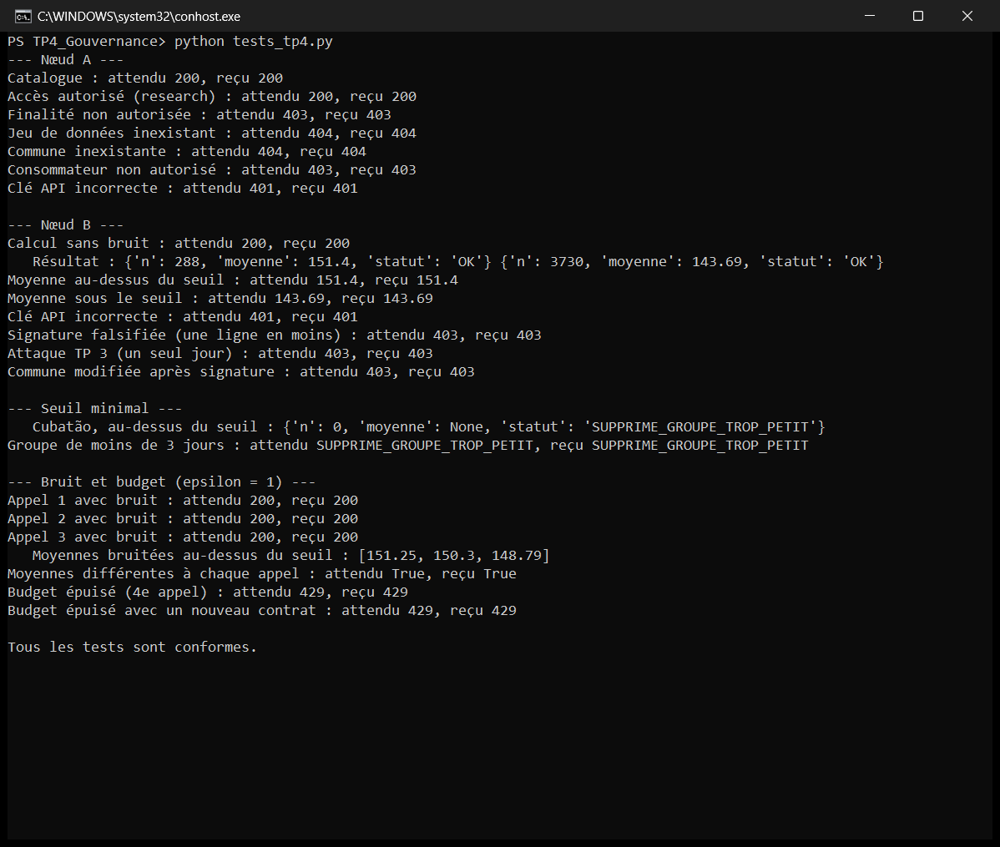

# Mini-espace de données fédéré : santé et qualité de l'air

Prototype d'espace de données entre trois organisations, construit en quatre TP avec Python, SQLite et FastAPI, sur des données réelles de l'État de São Paulo (2015-2025).

Le projet répond à une question simple, sans regrouper les données au même endroit :

> Les jours où l'air est très pollué, y a-t-il plus d'hospitalisations pour des problèmes respiratoires ?

Le rapport complet est disponible ici : [Rapport_Mini_Projet_Data_Spaces.pdf](Rapport/Rapport_Mini_Projet_Data_Spaces.pdf).

## Les acteurs

| Acteur | Ce qu'il possède | Rôle |
|---|---|---|
| A, Direction de l'environnement | Mesures de PM2.5 par jour | Publie un catalogue, crée les contrats, signe les classifications |
| B, Hôpital | Admissions respiratoires par jour | Calcule les statistiques dans sa propre base |
| C, Laboratoire | Rien au départ | Coordonne l'analyse sans ouvrir les bases |

## Les quatre TP

Chaque TP corrige un défaut du précédent.

| TP | Question traitée | Ce que reçoit le laboratoire | Protection ajoutée |
|---|---|---|---|
| 1 | Où sont les données ? | Rien | Deux bases séparées |
| 2 | Comment communiquer ? | Toutes les données brutes | Aucune |
| 3 | Comment éviter d'envoyer les données brutes ? | Catégories de pollution, moyennes | Clé API, calcul local |
| 4 | Comment contrôler l'usage ? | Catégories signées, moyennes | Catalogue, contrat, signature HMAC, seuil minimal, bruit de Laplace, budget ε |

## Structure du dépôt

```text
.
├── README.md
├── requirements.txt
├── Rapport/
│   └── Rapport_Mini_Projet_Data_Spaces.pdf
├── TP_Espace_Sante/              TP 1, 2 et 3
│   ├── tp_federation.py          reconstruit les bases (TP 1)
│   ├── consulter_bases.py
│   ├── api_air.py, api_hopital.py, client_analyse.py
│   ├── api_air_v3.py, api_hopital_v3.py, laboratoire_v3.py
│   ├── tests_acces_tp3.py, attaque_difference.py
│   └── environnement.db, hopital.db
├── TP4_Gouvernance/              TP 4
│   ├── setup_data.py             reconstruit les bases du TP 4
│   ├── api_air.py, api_hopital.py, client_laboratoire.py
│   ├── calcul_manuel.py, tests_tp4.py
│   └── environnement.db, hopital.db
└── captures/                     captures d'écran
```

## Prérequis

Le projet a été testé avec **Python 3.13.5 sous Windows**.

Dépendances, avec leurs versions exactes dans [requirements.txt](requirements.txt) : FastAPI, Uvicorn, Pydantic, Requests et PyArrow.

## Installation

À faire une seule fois, à la racine du projet :

```bat
python -m venv .venv
.venv\Scripts\activate
python -m pip install -r requirements.txt
```

Dans chaque nouveau terminal, activez l'environnement depuis la racine avec `.venv\Scripts\activate`, puis placez-vous dans le dossier du TP.

Si PowerShell refuse l'activation, utilisez l'invite de commandes (`cmd.exe`).

Les bases SQLite sont fournies. `tp_federation.py` et `setup_data.py` servent à les reconstruire à partir des données sources, qui ne sont pas dans ce dossier : il n'est pas nécessaire de les lancer.

## Lancement

| Port | Service |
|---|---|
| 8001 | API Environnement |
| 8002 | API Hôpital |

Lancez les API dans l'ordre indiqué, puis arrêtez-les avec `Ctrl+C` avant de passer au TP suivant, car les mêmes ports sont réutilisés. La documentation interactive de chaque API est disponible sur `http://127.0.0.1:<port>/docs`.

### TP 1 : stockage fédéré

Dans le dossier `TP_Espace_Sante` :

```bat
python consulter_bases.py
```

### TP 2 : communication par API REST

Dans le dossier `TP_Espace_Sante`, avec un terminal par commande :

```bat
python -m uvicorn api_air:app --port 8001
python -m uvicorn api_hopital:app --port 8002
python client_analyse.py
```

### TP 3 : calcul local et contrôle d'accès

Dans le dossier `TP_Espace_Sante`, lancez chaque API dans son propre terminal :

```bat
python -m uvicorn api_air_v3:app --port 8001
python -m uvicorn api_hopital_v3:app --port 8002
```

Puis, dans un troisième terminal :

```bat
python laboratoire_v3.py
python tests_acces_tp3.py
python attaque_difference.py
```

### TP 4 : gouvernance et confidentialité

Dans le dossier `TP4_Gouvernance`, **sans l'option `--reload`**, car les contrats sont gardés en mémoire. Lancez chaque API dans son propre terminal :

```bat
python -m uvicorn api_air:app --port 8001
python -m uvicorn api_hopital:app --port 8002
```

Puis, dans un troisième terminal :

```bat
python client_laboratoire.py
python client_laboratoire.py --bruit
python calcul_manuel.py
python tests_tp4.py
```

Pour vérifier que le budget survit à un redémarrage : après `tests_tp4.py`, arrêtez puis relancez l'API Hôpital, et exécutez :

```bat
python tests_tp4.py --apres-redemarrage
```



## Budget ε

Le budget est enregistré dans `TP4_Gouvernance\hopital.db` : 3 calculs bruités au maximum pour le consommateur `laboratoire-iasd` (avec ε = 1). Un nouveau contrat ou un redémarrage de l'API ne le remet pas à zéro.

`tests_tp4.py` le remet à zéro au début, puis l'épuise. Ensuite, `python client_laboratoire.py --bruit` s'arrête avec une erreur 429.

Pour remettre le budget à zéro, depuis le dossier `TP4_Gouvernance` :

```bat
python -c "import sqlite3; c = sqlite3.connect('hopital.db'); c.execute('DELETE FROM budget_confidentialite'); c.commit(); c.close()"
```

## Données

Le projet utilise le jeu de données suivant, sous licence CC BY 4.0 :

> Arcoverde, J. R. L. F. & Maciel, C. D. (2026). *Air quality and respiratory hospitalizations in São Paulo State, Brazil* (Version 1.0) [Data set]. Zenodo. https://doi.org/10.5281/zenodo.23164494

La pollution vient de la CETESB et les hospitalisations du SIH/SUS (hôpitaux publics du Brésil). Seules les tables agrégées par commune et par jour sont utilisées, sans aucune donnée par patient.

| Base | Dossier | Lignes | Communes |
|---|---|---|---|
| `environnement.db` | `TP_Espace_Sante` et `TP4_Gouvernance` | 55 842 | 24 |
| `hopital.db` | `TP_Espace_Sante` | 2 591 610 | 645 |
| `hopital.db` | `TP4_Gouvernance` | 96 432 | 24 |

Les deux bases viennent d'une même source publique, découpée en deux pour simuler deux organisations. São Paulo est utilisé comme cas réel, faute de données ouvertes d'admissions journalières trouvées au Maroc.

## Résultats

Analyse sur la commune de São Paulo, la seule mesurée sur les 4 018 jours, avec un seuil pédagogique de 30 µg/m³ de PM2.5 :

| Groupe | Jours | Moyenne d'admissions par jour |
|---|---|---|
| PM2.5 > 30 µg/m³ | 288 | 151,40 |
| PM2.5 ≤ 30 µg/m³ | 3 730 | 143,69 |

L'écart est de **7,71 admissions par jour**. Il vaut 6,34 en comparant à l'intérieur de chaque mois de chaque année, et 9,55 sans les années 2020 et 2021. Il montre une association, pas une causalité.

## Limites

- **Prototype pédagogique :** les clés et le secret sont des valeurs de démonstration, et les échanges se font en HTTP. Ce projet ne doit pas être exposé sur Internet.
- **Calcul sans bruit :** le laboratoire peut encore demander un résultat sans bruit (`apply_dp=False`), ce qui ne consomme pas le budget ε. Cette option est conservée pour comparer les résultats avec et sans bruit pendant la démonstration. En conditions réelles, l'hôpital devrait imposer le bruit côté serveur.
- **Confidentialité :** le bruit de Laplace utilisé ici n'est pas une implémentation complète de la confidentialité différentielle, et le seuil de 3 jours n'est pas du k-anonymat.
- **Données PM2.5 incomplètes :** les mesures ne couvrent que 24 communes, alors que la base hospitalière des TP 1 à 3 en contient 645 (celle du TP 4 ne garde que les 24 communes mesurées), et certains jours peuvent manquer. Les valeurs absentes n'ont pas été complétées artificiellement : l'analyse porte uniquement sur les couples commune-jour réellement mesurés, et ses résultats ne représentent donc pas tout l'État de São Paulo. Le jeu source contient déjà des moyennes journalières, calculées avec les filtres de complétude décrits dans son README (au moins 18 valeurs horaires valides par jour).
